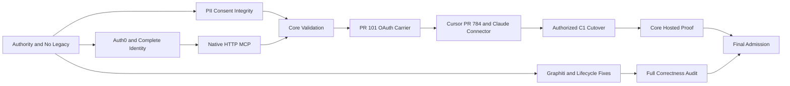

# Memory 3.0: Full Cutover and Correctness Remediation

**As of 2026-10-27. Status: working plan, NOT admitted, NOT dispatched, NOT implemented.**
**Main source:** [`Quantum-L9/l9-graphiti-memory@eb0bcbed1e1652529675af52584185d2f09dd737`](https://github.com/Quantum-L9/l9-graphiti-memory/tree/eb0bcbed1e1652529675af52584185d2f09dd737)
**Open release carrier:** [PR #101](https://github.com/Quantum-L9/l9-graphiti-memory/pull/101) at `52d1e4bba2ab8f56f1e73bb5254b79d8e3a818f2` (unmerged, signed-agent only, incompatible with this successor target).
**Open consumer:** [Cursor-Governance PR #784](https://github.com/Quantum-L9/Cursor-Governance/pull/784) at `e9c42599c83ceefccd33576fd6ea9d085e5c3cc8` (unmerged).
**Predecessor:** `history/c1_shared_memory_campaign_replacement_v1.2.zip` SHA256 `7cb2736e64d3d5ed892f9f34346b9b626653253cad634e61afcdf46089a500c2`.

## Operator decisions, now applied as planning constraints

1. **Full cutover, zero historical compatibility.** The 2.x Memory stdio, signed-agent/HMAC, static-bearer, SQLite runtime fallback, compatibility migration queue and old installed client paths are to be removed. No feature flag or hidden fallback reopens them.
2. **One Memory control plane** with a single OAuth-protected native MCP Streamable HTTP service, one new isolated PostgreSQL 16 canonical store and existing `memory.quantumaipartners.com` C1 route.
3. **Auth0** is the selected issuer, subject to a real RFC8707 resource, audience, client/PKCE and metadata proof. Do not implement a second authorization server.
4. **Complete identity coordinates:** product, release, runtime, actor, surface and constellation applicability remain distinct. Verified OAuth principal is not itself an attested agent or mobile surface. Unknown stays Unknown and consequential actor writes fail closed.
5. **Global authority stays upstream** in `Quantum-L9/.github`; the admitted `l9.product-kind-exception/memory-hosted-service@1` applies. Memory owns service and release/runtime, Cursor-Governance consumes canonical actor/surface projection, l9-deploy owns hosting.
6. **No premature C1 mutation.** The earlier operator-approved scope permits retiring only the old 2.2.0 Memory service and its SQLite store after the replacement is proven. The old backup is reported verified; do not reimpose an old-backup retest. Existing Graphiti/Neo4j and Cognitive Runtime are protected.
7. **No unsupported capabilities.** Outbound Graphiti HTTP projection is a different interface from inbound Memory stdio. Its correctness work stays in the full-remediation track; it need not be enabled for first PostgreSQL-only service operation. Zep is retired unless its current consumer and live qualification are proved.

## Two distinct completion milestones

| Milestone | Gate | What it proves | What it does **not** prove |
|---|---|---|---|
| **Core C1 shared-memory service** | `CUT-13` | One OAuth-only MCP service, new durable PostgreSQL, real approved clients, grants, complete identity evidence, no legacy paths, safe cutover | That Graphiti, Zep, retention and the unexamined 100 modules are all correct |
| **Full audited product remediation** | `CUT-14` | All 20 confirmed findings and nine concerns dispositioned by source/test or proven code retirement, targeted provider/maintenance qualification and complete source review | That the operator has admitted the release |
| **Final authorized admission** | `CUT-15` | Independent evaluation of the exact release, hosted deployment, full audit and operator intent | New work or rights outside the declared boundaries |

## Scope and truthful evidence

* Audit pass 2 reported **20 confirmed defects (HIGH 1, MEDIUM 8, LOW 11)** and nine unresolved concerns. Five sandbox reproductions were not the repository suite. The existing summary reports 36 fully read, eight partially read, 100 unread of 144 first-party modules. The file `source_coverage.yaml` was **not attached**, so per-module completeness cannot be asserted.
* Connector line-range reads in this campaign verified portions previously blocked by file-size truncation, including both SQL outbox lease/deletion methods. That removes the source-access excuse, not the unexecuted integration tests.
* Neither the Memory code nor Auth0/Claude UI was mutated during this planning run. Every new test name in this pack is a proposed test contract, not an executed test.

## Architecture and dependency graph

See `graphs/00_WORKSTREAMS.svg`, `graphs/01_PR_PIPELINE.svg`, `graphs/02_DETAILED_DAG.svg`, and `remediation_graph.json`. **Dependency direction:** `must_precede` source -> target.

## Workstream census

| Workstream | Detailed nodes | Scope |
|---|---:|---|
| AUTH | 17 | Auth0 OAuth resource protection, principal and full identity assurance |
| CONS | 10 | Cursor/Claude host-native OAuth clients and honest surface proof |
| CUT | 15 | Operator-controlled C1 switching, persistence and acceptance |
| DATA | 10 | Non-destructive PII/consent/evidence integrity |
| GOV | 12 | Authority, ADR supersession, identity topology and source audit |
| HYG | 3 | Residual command/teardown/error taxonomy safety |
| LIFE | 12 | MemoryService capabilities, leases, retirement and deletion atomics |
| MCP | 12 | Single MCP Streamable HTTP protocol, no Memory stdio |
| OPS | 11 | Memory-owned carrier and l9-deploy operational preflight |
| PROJ | 14 | Graphiti provider correctness and conditional Zep qualification |
| QA | 12 | Source, tests, regressions, independent evidence and no-false-green checks |
| RET | 6 | Global reference-safe retention and maintenance |
| STOR | 9 | Postgres-only runtime, secrets and legacy storage removal |

**Total:** 143 implementation, evidence, decision and gate nodes with 293 directed prerequisite edges. The counts are work inventory, **not progress metrics**.

## First discriminating proofs

**Before implementing infrastructure assumptions:** `AUTH-01` must prove an actual Auth0 resource-parameter/PKCE audience grant with the intended native clients. Auth0's resource-parameter compatibility profile is documented as essential when clients send `resource=` rather than Auth0's traditional `audience=`; current tenant configuration has not been observed. In parallel `GOV-03` records the new successor ADR and `DATA-01`/`DATA-04` establish destructive-data negative fixtures.

**Before any signed-agent code is retired in a published candidate:** `AUTH-13` must prove the complete identity assertion and server-side grants. **Before any C1 switch:** `QA-03`, `QA-04`, `MCP-12`, `OPS-07`, `OPS-08`, `CUT-03` and `CUT-04` must have receipts. **Before full product correctness:** `CUT-14` requires `QA-02` complete audit and qualified Graphiti or explicit provider non-activation.

## Publication and authorization

Follow repository `AGENTS.md`: every code PR has contract/migration impact, exact wiring, tests and rollback, and passes `bash scripts/validate_release.sh`. Publish through the canonical **`make pr` only** interface. Independently audit each corrected head before merging; one implementation campaign at a time. Operation, Auth0 mutation, deployment, release admission and old-service removal remain separately authorized real-world actions.

The original existing campaign remains in `history/`, and its `C1_RECON_EVIDENCE.md` and `OPERATOR_DECISION_2026-10-26.md` are preserved byte-for-byte at package root. The no-compatibility decision supersedes its old planned **signed-agent** future, not historical source evidence.
