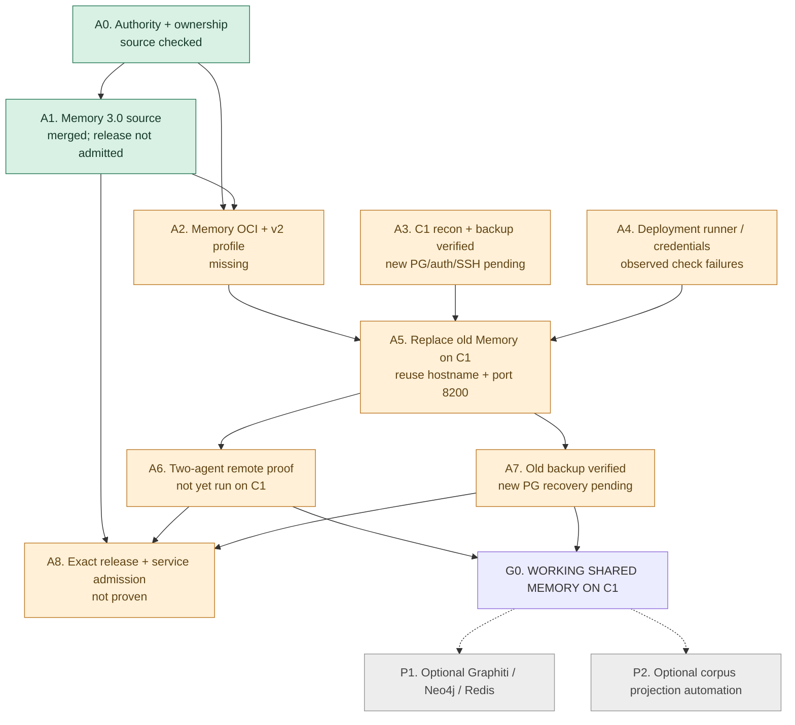

# C1 Shared Memory Campaign

**As-of:** 2026-10-26 | **Revision:** 1.2 (operator-verified backup and in-place Memory replacement) | **Mode:** GAR Architect + Strategic Planner | **Status:** working candidate, not an admitted canonical Strategic Plan

## Bottom line

Memory 3.0 remote-service implementation is merged, and its signed-agent PostgreSQL multi-process test is reported passing. C1 already hosts a legacy 2.2.0 SQLite Memory service and a valuable Graphiti/Neo4j tenant, but no newly hosted Memory 3.0 shared-PostgreSQL deployment or two-machine operation has been evidenced. Replace the old Memory service **in place** on C1 with Memory 3.0 using the existing l9-deploy transport and prove it with two independently authenticated agents. The operator has backed up and verified the old SQLite store and explicitly authorized its retirement and deletion; **Graphiti/Neo4j remain protected**.

## The campaign graph

The dotted branches are **not prerequisites**. Steps A2 (Memory package), A3 (C1/DB/secrets preflight) and A4 (runner diagnostics) can proceed independently, without concurrent changes to a shared protected host. C1 identity and the legacy workload/port census are now grounded in [October 13 reconnaissance](https://www.dropbox.com/scl/fi/051ob10wo07xb8pl5qyz9); current-state checks remain separate from historical evidence.

## Repo and authority map

| Repository | Frozen main | Campaign responsibility | Allowed changes now |
| --- | --- | --- | --- |
| `Quantum-L9/.github` | `3dcdeaae355b6de08562993f705084d7a3714bfd` | Canonical global law, admitted Memory hosted exception, authority and profiles | None indicated by evidence |
| `Quantum-L9/l9-semantic-compiler-engine` | `e07a143a7c1c642c8c3c4cba57897292a40a78f7` | Mechanically project / validate typed semantic closure and derived manifests | None indicated by evidence |
| `Quantum-L9/l9-graphiti-memory` | `eb0bcbed1e1652529675af52584185d2f09dd737` | Canonical `MemoryService`, HTTP server, client, release, Dockerfile/profile/consumer workflow | Candidate changes require separate implementation authorization |
| `Quantum-L9/l9-deploy` | `b1bdaac50e22ddda526bd99203f498b6b4afd437` | Release transport, immutable image deployment, C1 host conformance, receipts and rollback | Candidate changes require separate implementation authorization |
| `Quantum-L9/l9-cognitive-runtime` | `94348537bb775d7fa1eb06f950d04dbde2442875` | Neighbor on C1. Provides reference for host identity, port and ingress collision avoidance | **READ ONLY** |

The Memory product remains an L9 **Dependency** under the admitted centrally-hosted-service exception, available only from release 3.0.0. It does not become a Constellation node or acquire Gate routing. Authentication is signed-agent request identity with server-owned keys/grants. PostgreSQL is canonical; Graphiti and Redis are optional projections or active-memory enhancements.

## Grounded findings

1. **Implementation:** Memory PR [#96](https://github.com/Quantum-L9/l9-graphiti-memory/pull/96) merged on 2026-10-16 and PR [#100](https://github.com/Quantum-L9/l9-graphiti-memory/pull/100) merged on 2026-10-19. 3.0.0 source version and memory-owned `RemoteMemoryClient` exist. [Main CI passed](https://github.com/Quantum-L9/l9-graphiti-memory/actions/runs/39333387195). A passing source test is not hosted proof.
2. **Release:** GitHub `v3.0.0` tag was not found, nor was an exact 3.0 admission receipt in the main tree. [Release law](https://github.com/Quantum-L9/l9-graphiti-memory/blob/eb0bcbed1e1652529675af52584185d2f09dd737/release-work/product-release-binding.yaml) requires exact source, wheel and sdist evidence; hosted service admission is separate.
3. **Packaging:** At frozen Memory main, no Dockerfile and no `.l9/deployment.yaml` exist. The smallest new Memory code is the carrier, not a second service. [Canonical deployment interface](https://github.com/Quantum-L9/l9-deploy/blob/b1bdaac50e22ddda526bd99203f498b6b4afd437/docs/runbooks/onboard-consumer.md).
4. **Deployment platform:** Prior [dispatch](https://github.com/Quantum-L9/l9-deploy/actions/runs/40019807900) validated its request but failed at independent authorization and skipped deployment; staging approval exemption then [merged in PR #61](https://github.com/Quantum-L9/l9-deploy/pull/61). No later successful deploy dispatch observed.
5. **C1 operations:** Today's [runner conformance](https://github.com/Quantum-L9/l9-deploy/actions/runs/40315689453) fails the management CIDR/nft rule assertion. Today's [drift probe](https://github.com/Quantum-L9/l9-deploy/actions/runs/40304987574) fails parsing the Infisical environment. Diagnose before modifying the firewall or secrets contracts.
6. **C1 neighbor:** Cog's [read-only staging contract](https://github.com/Quantum-L9/l9-cognitive-runtime/blob/94348537bb775d7fa1eb06f950d04dbde2442875/.l9/deployment.yaml) claims `mcp-staging.quantumaipartners.com` and host port `18080`. Reserve a different hostname/port for Memory. No Cog mutation or redeployment.
7. **Unrelated red jobs:** Graphiti [qualification](https://github.com/Quantum-L9/l9-graphiti-memory/actions/runs/40304847918) fails following `gpt-4.1-nano` deprecation. Repository corpus [projection](https://github.com/Quantum-L9/l9-graphiti-memory/actions/runs/40328872941) lacks GitHub Actions permission to create PRs. Neither is a prerequisite to canonical PostgreSQL memory unless release validation makes it so.

## C1 recon reconciliation (2026-10-26)

The October 13 Hetzner API census and later host inspection identify C1 precisely as **server ID 114194366 / 46.62.243.82**, with no Hetzner private NIC at the time, `c1-k8s-firewall` attached, Caddy on 80/443, legacy Memory **2.2.0 / SQLite / loopback 8200**, Graphiti **loopback 8100**, Neo4j with **6,441 episodes**, a daily VM backup window, and available pre-rebuild snapshot **443133337**. The separate `L9-Memory` VM **119722208 / 89.167.34.78** is *not* C1. See [C1 Recon Evidence](C1_RECON_EVIDENCE.md) and the [original evidence archive](https://www.dropbox.com/scl/fi/051ob10wo07xb8pl5qyz9).

**Consequences and new operator decision (October 26):** C1 discovery is complete. The operator **completed and verified the legacy SQLite backup** and **authorized retiring and deleting the legacy Memory 2.2.0 service and store**, with **no further old-backup validation required**. Retain that backup outside the service. Reuse the existing `memory.quantumaipartners.com` Caddy endpoint and the **loopback port 8200** after stopping the old Memory listener, subject only to checking that current routing/port ownership is unchanged. This is a **replacement**, not a second permanent Memory service. Do **not** touch the separate `/graphiti/*` -> 8100 route, Graphiti/Neo4j data, or Cog. Before the protected change, check the current trusted SSH host key, runner route, and new PostgreSQL/Infisical inputs. The [Cognitive Runtime checkpoint](https://www.dropbox.com/scl/fi/ljitcgii8p641soe074xe) confirms the generic v2 dispatch pathway already passed validation for Cog; **reuse** it for Memory.

**Security caveat:** October 13 recon observed unauthenticated legacy `/graphiti/mcp` tool inventory access. Current exposure is not proven; independently recheck and handle any remediation through the correct C1 owner, without enlarging this Memory deployment slice.

## Operator-approved legacy Memory retirement (2026-10-26)

**Decision:** The user completed **and verified** the backup of the *old C1 Memory SQLite store*, and explicitly authorized deleting the old store and replacing its service with the new PostgreSQL-backed Memory 3.0 service. This is an accepted **operator attestation**, not a repository or live-host receipt. No further legacy backup test or legacy ledger migration is required. The old backup is retained outside the retired service.

**Controlled replacement:** (1) prepare and qualify Memory 3.0 image, isolated PostgreSQL, per-agent auth/grants and deployment path; (2) verify current Caddy config and exact legacy systemd service/SQLite ownership; (3) stop and disable only `l9-memory-server` 2.2.0 to release `127.0.0.1:8200`; (4) activate new 3.0 service bound to the freed loopback port through the existing Caddy Memory route; (5) prove `/readyz`, signed `/mcp`, cross-agent persistence and no Graphiti/Cog regression; (6) delete retired old SQLite/service files within the **authorized exact scope** after the successful switch; (7) preserve the verified backup and a rollback path. If the switch fails, roll back the app safely without deleting either the backup or unrelated data.

**Not approved by this decision:** deletion of the separate Graphiti/Neo4j corpus, editing Cognitive Runtime, release/admission shortcuts, arbitrary host changes, or a destructive cutover before the replacement is technically ready. Recovery testing of the **new PostgreSQL store** is a separate requirement and remains open.

## Acceptance oracle: what actually proves the mission

Run from **independent clients on separate machines** against the deployed C1 endpoint, not a unit fixture:

1. Agent `A` authenticates with its own key + sealed identity, writes a tagged test record in shared namespace `N`, and receives an accepted, attributable write receipt.
2. Agent `B` with a different identity reads/searches the **same record ID and content** from C1, with correct namespace.
3. Agent `B` cannot access a distinct forbidden namespace. An unregistered agent fails authentication; an unauthorized write is rejected. Test both read and write refusals.
4. A repeated idempotency key returns the same record rather than a duplicate. Agent attribution remains `A`.
5. Restart the Memory HTTP process; agents reconnect; record persists in PostgreSQL with the same record ID. A network failure never falls back to local SQLite or local memory.
6. Confirm TLS, `/readyz`, exact image/source digests, no old Memory 2.2.0 process running, no collision with Cog and no change to `/graphiti/*`. Prove **new PostgreSQL** backup/isolated restore and application rollback readiness before operationally valuable records are stored. **Do not re-test the verified legacy SQLite backup.**

**Pass:** all six observed with time-stamped, revision-bound receipts, plus bounded legacy-service retirement proof. **Fail:** an unknown or skipped requirement is not reclassified as passed.

## First bounded engineering slice

**A2: Memory deployment carrier only.** Target `l9-graphiti-memory` at a new PR, with one minimal Dockerfile using the existing HTTP server, image smoke/integration proof, `.l9/deployment.yaml` v2 carrying verified C1 target facts, and one thin CI/release caller invoking the existing platform interface. Use the **existing hostname and loopback 8200** for the replacement; no new URL or permanent parallel Memory service. Keep Postgres canonical, Infisical credentials out of the repository, `/readyz` operational, and signed MCP authentication mandatory. Validate source, product semantics and deploy schema. Source publication and deployment follow their established gates; the **specific legacy retirement/deletion scope is already operator-authorized**.

In parallel, **A3/A4 targeted freshness checks** reuse the verified C1 census, then confirm current Caddy routing and **the planned port-8200 handover**, PostgreSQL role isolation, per-agent keys/grants, new-store backup/restore ownership, runner nft rule and Infisical/OIDC route. The historical host observations are not live deployment proof. Neither lane touches Cog or Graphiti.

## Out of scope and change control

Graphiti/Neo4j/Redis full-capability operation, corpus automation, Cognitive Runtime integration, global law amendments, deployment platform redesign and new auth products are postponed. If a current conformance rule makes one a real prerequisite, attach the exact failing receipt and route to its existing owner rather than expanding scope silently.

The graph and implementation sequence are a **planning candidate**, not canonical Plan Keeper state, release admission, running-service admission, or a claim that C1 has been changed.
